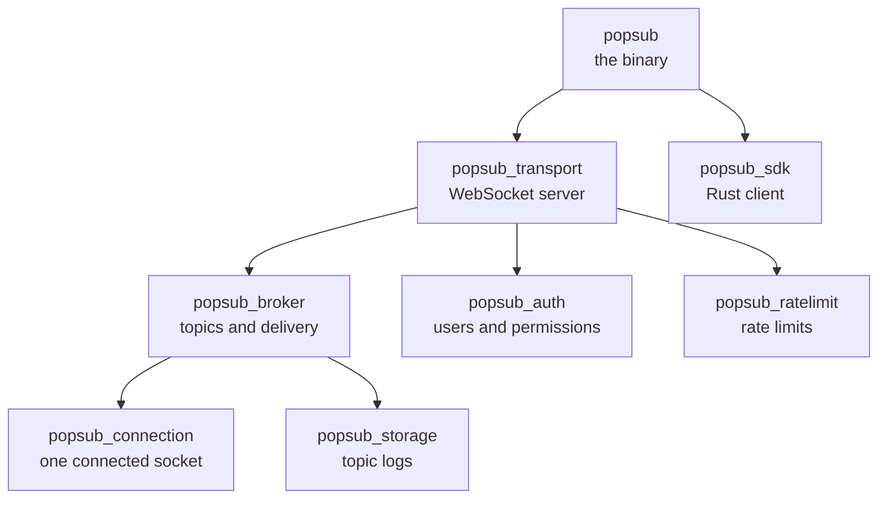
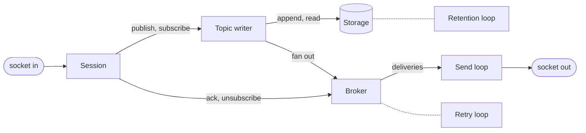
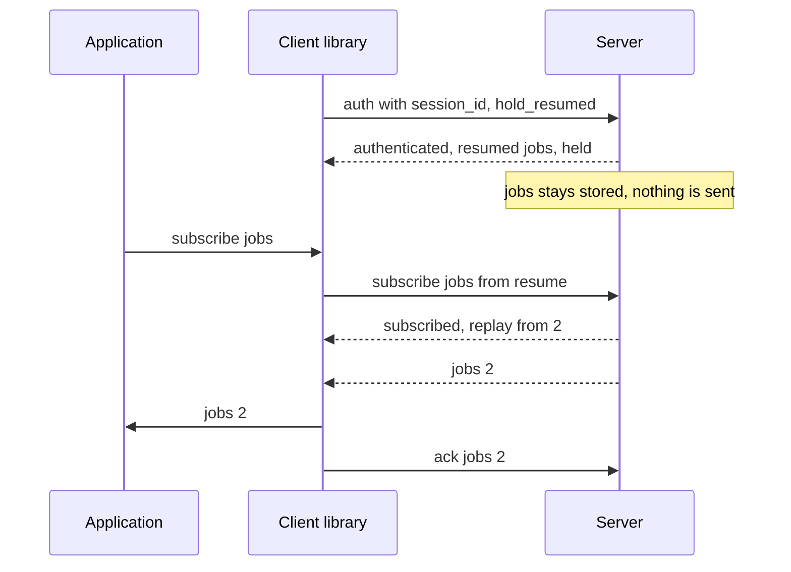

# PopSub design

| | |
|---|---|
| Status | Describes `main` as of November 2026, after the 0.1.0 release, plus the known gaps and the proposed direction |
| Owner | Soumyadeep Ghosh |
| Scope | The broker, its WebSocket protocol, persistence and delivery guarantees |

## 1. Summary

PopSub is a single-process publish/subscribe broker written in Rust. Clients connect over WebSocket, log in as a user with per-topic permissions, and then subscribe to topics or publish to them using a small JSON protocol. Logins, registrations and publishing are rate limited. Messages can be sent fire-and-forget (QoS 0) or with acknowledgements and retries (QoS 1). Every message is appended to a per-topic log with a sequence number, kept in a directory on disk by default, so subscribers can replay history and durable sessions resume where they left off after a reconnect or a restart.

This document describes how the system works today, where its guarantees hold and where they don't, and the changes needed before other people can depend on it.

## 2. Goals and non-goals

**Goals**

- Small enough to read in an afternoon. A newcomer should be able to trace a message from socket to subscriber without a diagram.
- One binary, no external services. `cargo run` and a directory on disk is the whole deployment.
- Honest delivery semantics: every guarantee the README makes should be backed by a test.
- A protocol any language can speak with a WebSocket library and a JSON parser.
- Fit for production use by small applications on one box, and, once the gaps in section 12 are closed, by IoT devices.

**Non-goals (for now)**

- Clustering or replication. A single node is the unit of deployment. Section 13 discusses how this could change.
- Competing with Kafka, NATS or Redis Streams on throughput.
- Exactly-once delivery. At-least-once plus idempotent consumers is the intended model.
- Binary WebSocket frames. Payloads are JSON strings; a body that isn't text travels as base64 with `encoding: "base64"` (section 4.1).

## 3. Architecture

### 3.1 Crates

An arrow means "depends on". Three crates are left out because nearly everything uses them: `popsub_protocol` (the frame types), `popsub_config` (settings) and `popsub_utils` (errors, logging, metrics). `popsub_scenarios`, the client scenario suite, sits beside the binary.

| Crate | Responsibility |
|---|---|
| `popsub` | Binary. Parses the CLI, loads config, refuses published default secrets on public addresses, opens the configured storage backend, starts the broker, the retry, retention and session expiry loops and the WebSocket server, and exits with a failure status when any of that fails. Also has the `users` and `topics` admin commands and a small demo client. |
| `popsub_transport` | `Server` (shared state and the accept loop) and `Session` (one connection, one method per message type). Parses `ClientMessage` JSON, runs register, login and auth, checks topic permissions and rate limits, and turns requests into broker calls. |
| `popsub_auth` | Users and roles, Argon2id password hashing, JWT issue and validation, topic permission patterns. Users are kept in `users.json` in the storage directory with the `file` backend (`FileUserStore`), in memory with the `memory` backend, or in Postgres behind a feature flag. |
| `popsub_ratelimit` | Token bucket, sliding window and login lockout limiters, keyed by string, with pruning of idle keys. |
| `popsub_broker` | One writer task per topic that appends to the log, fans records out in `seq` order and replays history to subscribers; the synchronous `Broker` with subscriber sets and the QoS 1 pending table; all shared through `SharedBroker`. |
| `popsub_sdk` | The Rust client: login and token refresh, reconnection with backoff guided by close codes, resubscription without gaps, confirmed publishes resent under the same id, acknowledgements and deduplication by `(topic, seq)`. The CLI's demo client uses it. |
| `popsub_protocol` | Every frame clients and the server exchange, the error codes and `PROTOCOL_VERSION`. Depends only on `serde`, so client SDKs can use it. |
| `popsub_storage` | Per-topic logs with sequence numbers, subscription cursors, the `Storage` traits, the `file` and `memory` backends and the conformance suite every backend must pass (`docs/STORAGE.md`). |
| `popsub_connection` | `Client`, the server's record of one connected socket (id, `Outbox`, authenticated flag, username, durable session), and `Outbox`, its outgoing queue with a byte budget. |
| `popsub_config` | Loads `Settings` from `config/default.toml` and environment variables, falling back to defaults. Reports published default secrets. |
| `popsub_utils` | `PopSubError`, the shared `Result` alias, logging setup, every OpenTelemetry metric instrument (`metrics`), and PII masking (`pii`). |

Dependencies point downwards only. The broker knows nothing about WebSockets, users or permissions; the transport checks those before calling it.

### 3.2 Runtime

Solid arrows are the path of a message; dotted lines attach the background loops to what they work on. Replies to a request skip the broker and go from the session straight to the send loop, and the session calls `AuthService` for register, login and auth.

- **Server.** Holds what every connection shares (broker, auth service, rate limiters) and runs the accept loop. A failed `accept` is logged and retried after 100 ms instead of stopping the server.
- **Session.** One per socket, in its own task. Reads frames, parses JSON, and calls the method for the message type. Replies are queued on the session's own outgoing channel, so replying never takes the broker lock.
- **Send loop.** One per socket. Drains the client's channel and writes frames. Whichever of the session and the send loop ends first removes the client from the broker.
- **Topic writer.** One task per topic, started on first use. Every publish and subscribe for the topic is queued to it and handled one at a time: it appends to the topic log in storage without holding the broker lock, then takes the lock briefly to fan the record out. Subscribes replay history from the log and then add the subscriber, with no publish handled in between, so replay and live delivery never overlap or leave a gap.
- **Broker.** A `SharedBroker`: the broker behind one `std::sync::Mutex`, reachable only through `with(|broker| ...)`. A closure can't await, so the lock is never held across an await point. If a task panics while holding it, the next caller logs the poisoning and carries on with the broker's state instead of panicking too.
- **Retry loop.** `SharedBroker::run_retry_loop` wakes every second and runs one `Broker::retry_overdue` pass, which resends overdue QoS 1 messages. A record out of retries stalls its subscription, or, with `broker.dead_letter_topic` set, is copied there and dropped from the window (section 5.3).
- **Retention loop.** `SharedBroker::run_retention_loop` trims every topic log to the retention limits once a minute, so quiet topics still age out. Publishing also trims the topic it appended to.
- **Session expiry loop.** `SharedBroker::run_session_expiry_loop` wakes every minute, touches the sessions and shared subscription groups that are in use, and removes those not touched for `storage.session_expiry_secs` (section 5.4).
- **Auth service.** A plain `Arc<AuthService>`. Its methods take `&self` and the user store locks internally, so it needs no lock of its own and can never be held together with the broker lock.
- **Prune task.** Every minute, drops rate limiter entries for keys that have gone quiet. It stops when the server stops.
- **Health endpoints.** With `server.health_address` set, a small HTTP server answers `GET /healthz` (liveness: 200 whenever the process can answer) and `GET /readyz` (readiness: 503 while shutting down, or for 30 seconds after a failed topic append unless one succeeds since). It is separate from the WebSocket listener so a load balancer or orchestrator can probe it without speaking the protocol. The 30 second window exists because a server marked not ready gets no traffic, so no new append could clear the failure.

### 3.3 Observability

With `[telemetry] enabled`, the binary exports metrics, traces and logs with OpenTelemetry over OTLP (HTTP and protobuf, plain `http://` only), to `OTEL_EXPORTER_OTLP_ENDPOINT` (default `http://localhost:4318`). Transport and broker record through the OpenTelemetry API only; the binary installs the SDK (`crates/popsub/src/telemetry.rs`). With telemetry off every instrument is a no-op. Failed exports are dropped, never retried into the server's own work.

Metrics, all under the `popsub` instrumentation scope. Counters are cumulative; attributes in brackets.

| Name | Kind | What it counts |
|---|---|---|
| `popsub.connections` | gauge | Connections registered after their handshakes |
| `popsub.connections.opened` | counter | Connections admitted |
| `popsub.connections.refused` | counter | Connections turned away [`reason`: `server_limit`, `address_limit`, `handshake`, `tls`, `proxy_header`] |
| `popsub.connections.closed` | counter | Connections ended [`reason`: a close code's reason, or `client`] |
| `popsub.logins` | counter | Login attempts [`outcome`: `success`, `invalid_credentials`, `locked_out`] |
| `popsub.errors` | counter | Error frames sent [`code`] |
| `popsub.messages.published` | counter | New records stored, retries of stored ones excluded [`qos`] |
| `popsub.messages.delivered` | counter | Records sent to subscribers, live or caught up, retries excluded |
| `popsub.messages.redelivered` | counter | QoS 1 records resent after the acknowledgement timeout |
| `popsub.messages.acknowledged` | counter | QoS 1 acknowledgements accepted |
| `popsub.messages.in_flight` | gauge | QoS 1 records sent and not yet acknowledged |
| `popsub.subscriptions` | gauge | Live subscriptions |
| `popsub.subscriptions.stalled` | counter | Subscriptions paused after running out of retries |
| `popsub.messages.dead_lettered` | counter | QoS 1 records given up on for one subscription and copied to the dead-letter topic |
| `popsub.topics` | gauge | Topics with a writer or subscribers |
| `popsub.publish.duration` | histogram, seconds | Append, fan-out and trim in the topic writer |
| `popsub.storage.errors` | counter | Failed storage operations in the topic writers [`operation`: `append`, `trim`, `cursor`, `read`]. Failures elsewhere (the retention loop's trims, cursor stores on ack and retry, session attach and expiry) are logged but not counted |

Gauges are read from `SharedBroker::stats` at each export (every 60 seconds by default). Traces: one span per client request except `ack`, named `popsub <type>`, with `popsub.request.type`, `popsub.client.id`, and on failure `otel.status_code = ERROR` and `error.type` set to the error code; sampled by `telemetry.sample_ratio`, always kept when the parent was. Logs: every event at `info` and above, linked to the current span's trace, except events from the exporter's own HTTP stack. Identities in logs and span events are masked by default; see section 10.

## 4. Protocol

All frames are JSON text, tagged with `type`. The types live in `popsub_protocol`, which the server and client SDKs share. This is protocol version 1 (`PROTOCOL_VERSION`). A JSON Schema generated from those types is in `docs/protocol/` for SDKs in other languages; CI fails if it falls out of date.

- **Request ids.** Any client frame may carry an `id`, a number or a string. The reply carries the same `id`. Frames the server sends on its own have none.
- **Errors.** Every failure is `{"type":"error","id":...,"code":"...","message":"...","retry_after":...}`. `code` is one of `bad_request`, `unauthenticated`, `auth_failed`, `invalid_credentials`, `locked_out`, `rate_limited`, `not_authorized`, `registration_failed`, `invalid_session_id`, `session_unavailable`, `unsupported_protocol`, `storage_unavailable`, `payload_too_large`, `invalid_topic`, `forbidden`, `user_not_found`, `user_exists`, `topic_not_found` or `internal`. `retry_after` is set for `locked_out` and `rate_limited`.
- **Evolution.** Within a version, frames, fields and error codes are only added. Clients ignore fields and frame types they don't know, and treat an unknown error code like `internal`. Removing or changing anything needs a new version, named by the client in `auth`.

Topic names in `subscribe` and `publish` are 1 to 120 bytes (the `file` backend's limit, `popsub_storage::MAX_TOPIC_BYTES`) with no control characters and no `+` or `#`, which are kept for wildcard permission patterns. Anything else gets `invalid_topic`. `subscribe` and `unsubscribe` also take a pattern, in which a whole level may be `+` (any one level) and the last level may be `#` (the rest); see wildcard subscriptions below. `publish` never does.

### 4.1 Client to server

| `type` | Fields | Reply |
|---|---|---|
| `register` | `username`, `password` | `registered`. Only when `server.allow_registration` is on. Usernames are 3 to 32 letters, digits, `_`, `.` or `-`; passwords at least 8 characters. Allowed before `auth`. |
| `login` | `username`, `password` | `logged_in` with a JWT. Checked against the user store (Argon2id). Rate limited, see section 10. |
| `auth` | `token`, optional `protocol`, optional `session_id`, optional `clean_start`, optional `hold_resumed` | `authenticated`. With `hold_resumed` the session's stored subscriptions are listed in `resumed` but left unattached (`held: true` in the reply): nothing is sent on one until the client subscribes to it. Must succeed before anything below is accepted. A bad token, an unsupported `protocol` or a bad `session_id` closes the connection. A `session_id` (1 to 128 characters, no control characters) makes the connection hold that durable session of the token's user; see section 5.4. |
| `subscribe` | `topic`, optional `from`, optional `group` | `subscribed`, then history, then live records. Requires subscribe permission. `from` is `"resume"` (the default: one past a durable session's stored cursor, otherwise no replay), `"new"`, `{"last": N}`, `{"since_ms": T}` or `{"seq": S}`. `storage_unavailable` if the log or session store can't be read, in which case the client is not subscribed. |
| `unsubscribe` | `topic` | `unsubscribed`, even if the client wasn't subscribed. `storage_unavailable` if a durable session's stored subscription can't be removed. |
| `publish` | `topic`, `payload`, optional `encoding`, optional `message_id`, optional `qos` (0 or 1) | `published` for QoS 1, nothing for QoS 0. A `qos` other than 0 or 1 is refused with `bad_request` and nothing is stored. `payload` is always a string: the text itself, or with `encoding: "base64"` the base64 of a body that isn't text. The server checks an encoded payload is valid base64 (`bad_request` otherwise), stores the string and its encoding unchanged, and never decodes it. Requires publish permission and is rate limited per user. A repeated `message_id` from the same user is stored and delivered once while the original is retained. If storage fails, either QoS gets `storage_unavailable`. Payloads over `server.max_payload_bytes` get `payload_too_large`, and a `message_id` must be 1 to 128 characters. |
| `ack` | `topic`, `seq` | None. Confirms one QoS 1 record delivered to this connection. Anything not in flight to this connection is ignored. |
| `ping` | none | `pong`. Accepted before `auth`. For clients that can't see WebSocket pings (browsers) to check the connection is alive; it also counts as activity for the idle timeout. |

The admin requests below need an enabled admin; anyone else gets `forbidden`. A `role` is `{"kind": "admin" | "user" | "readonly", "topics": [{"pattern": "orders/#", "access": "subscribe" | "publish" | "both"}]}`, where `topics` may be left out, is ignored for `admin`, and allows only `subscribe` for `readonly`. Patterns are 1 to 120 bytes with no control characters and no empty levels; `+` must be a whole level and `#` the whole last level. An invalid name, password, pattern or role gets `bad_request`, a missing account `user_not_found`, and a taken name `user_exists`. The last enabled admin can't be disabled, deleted or demoted (`bad_request`), so a server always keeps one.

| `type` | Fields | Reply |
|---|---|---|
| `create_user` | `username`, `password`, `role` | `user`. Same username and password rules as `register`. |
| `get_user` | `username` | `user` |
| `list_users` | none | `users`, sorted by name |
| `set_role` | `username`, `role` | `user`. Replaces the role and its grants. |
| `grant` | `username`, `pattern`, `access` | `user`. Adds the grant, replacing one for exactly that pattern. Refused for admins, and for publishing on a `readonly` account. |
| `revoke` | `username`, `pattern` | `user`. Removes the grant for exactly that pattern; `bad_request` if there is none. |
| `set_password` | `username`, `password` | `user`. Tokens issued before it are refused at `auth` from then on, and the account's connections are closed with `token_expired` (4004), so they log in again. |
| `set_enabled` | `username`, `enabled` | `user` |
| `delete_user` | `username` | `user_deleted` |
| `list_topics` | none | `topics`: every topic that has a log, sorted by name |
| `get_topic` | `topic` | `topic_info`, or `topic_not_found` when nothing was ever published to it |
| `purge_topic` | `topic` | `topic_info` after removing every record the topic holds. Its numbering carries on (the next publish gets `last_seq + 1`), live subscriptions stay, and a subscriber that hadn't caught up gets `truncated` |

Changes take effect on live connections at once. After `set_role`, `grant` or `revoke`, each of the account's subscriptions its role no longer allows is ended: the connection gets `unsubscribed` with no `id`, and a durable session forgets it. Disabling or deleting an account closes its connections with `account_disabled` (4009), and its tokens are refused at `auth` from then on.

**Wildcard subscriptions.** `subscribe` with a pattern (`orders/#`, `sensors/+/temp`) subscribes the connection to every matching topic the user may read:

- The reply is `subscribed` for the pattern itself, with `replay_from` and `replay_to` 0.
- Each existing matching topic the connection isn't already subscribed to is then joined with the request's `from`, announced by its own `subscribed` frame with no `id`.
- A matching topic created later is joined when its first message is stored, from that message, again announced by `subscribed`. The user's permission is checked at that moment.
- Messages arrive under their own topic and `seq`, and are acknowledged with them. Replay, deduplication, windows and durable cursors all work per topic, as for a subscription by name.
- `unsubscribe` with the pattern forgets it and ends the topics joined through it (unless another of the connection's patterns still matches them). Topics the connection subscribed to by name are left alone.
- A pattern is not stored in a durable session; the topics joined through it are. After a reconnect the client subscribes to the pattern again. Sent with `from: {"seq": 1}`, that joins exactly the topics created while it was away, from their first message, because every topic it already holds is skipped.
- A pattern that matches nothing the user may read is accepted and stays empty. A malformed one gets `invalid_topic`.

**Shared subscriptions.** `subscribe` with a `group` (1 to 64 letters, digits, `_`, `.` or `-`) joins a group on an exact topic; a group with a pattern gets `bad_request`:

- A group belongs to the account that uses it. Two accounts naming the same group get a group each, so workers that split a topic's records log in as the same account, and another account can't join them by guessing the name.

- Each record on the topic goes to one member of the group, in turn, skipping members whose outgoing queues are full. Subscribers outside the group, and other groups, still get every record.
- The group has one position and one window of unacknowledged QoS 1 records (`broker.max_inflight`, for the whole group), and its position is stored under the group's name like a durable session's cursor, so it survives restarts, and periods with no members up to `storage.session_expiry_secs`, after which it is removed like an idle session. Records published while a group has no members wait for the next member.
- `from` only decides where a group starts the first time it is used on a topic (`resume` means `new`). Later members get `subscribed` with the group's current position as `replay_from` and their `from` is ignored. The `subscribed` frame names the `group`.
- A record is acknowledged by the member it was sent to. When a member disconnects or unsubscribes, its unacknowledged records are sent to another member at once, or wait for one. A record that times out is resent to the same member, and after `max_retries` the group stalls or the record is dead-lettered, as for any subscription.
- A member sees only its share, not in strict `seq` order, so clients deduplicate a shared subscription by remembering delivered `seq`s rather than by a next expected one, and rejoin with `resume` after a reconnect.
- A connection holds one subscription per topic: joining a group replaces its own subscription to that topic, and the reverse.

### 4.2 Server to client

| Frame | Shape |
|---|---|
| Registered | `{"type":"registered"}` |
| Pong | `{"type":"pong"}`, the answer to `ping` |
| Logged in | `{"type":"logged_in","token":"..."}` |
| Authenticated | `{"type":"authenticated","protocol":1,"limits":{"max_inflight":100,"session_expiry_secs":86400,"heartbeat_secs":30,"idle_timeout_secs":90,"max_payload_bytes":1048576,"max_topic_bytes":120}}`, plus `session_id` and `resumed` (the session's topics) for a durable session, and `held: true` when `hold_resumed` was asked for |
| Auth expiring | `{"type":"auth_expiring","expires_at_ms":1794800000000}`, a minute before the token expires |
| Subscribed | `{"type":"subscribed","topic":"...","replay_from":41,"replay_to":90}`, plus `group` for a shared subscription. Records `replay_from` to `replay_to` are history; later ones are live. Also sent, without an `id`, for each subscription a session restores. |
| Unsubscribed | `{"type":"unsubscribed","topic":"..."}`. Also sent, without an `id`, when an admin change ends a subscription the user may no longer read. |
| User | `{"type":"user","user":{"username":"...","role":{"kind":"user","topics":[...]},"enabled":true,"created_at_ms":1794800000000}}`, the reply to most admin requests. No password hash. |
| Users | `{"type":"users","users":[...]}`, the same objects |
| User deleted | `{"type":"user_deleted","username":"..."}` |
| Topic info | `{"type":"topic_info","topic":{"name":"orders","first_seq":3,"last_seq":9,"messages":7,"subscribers":2}}` |
| Topics | `{"type":"topics","topics":[...]}`, the same objects |
| Published | `{"type":"published","message_id":"...","seq":42}`, for QoS 1 only, once the record is stored |
| Message | `{"type":"message","topic":"...","seq":42,"message_id":"...","payload":"...","qos":0,"published_at_ms":1794800000000}`, plus `"encoding":"base64"` when the publisher sent one |
| Truncated | `{"type":"truncated","topic":"...","first_available":1300}`, before records that start later than the subscriber expected |
| Stalled | `{"type":"stalled","topic":"...","seq":42}`, when a record runs out of retries |
| Error | `{"type":"error","code":"not_authorized","message":"..."}`, plus `retry_after` for limits |

All replies also carry the request's `id` when it had one. The broker writes `message`, `truncated`, `stalled` and `subscribed` itself, using the same `popsub_protocol` types as the transport. The publisher's username is stored but not sent to subscribers.

### 4.3 Session order

1. Connect.
2. Optionally `register`. The connection stays open whatever the result.
3. `login`. Wrong credentials or a lockout produce an error and the connection stays open. Malformed frames get `bad_request` and the connection stays open too.
4. `auth` with the token. Failure closes the connection.
5. Any other request. Sending one before successful `auth` produces an error and closes the connection. A permission denial or a publish rate limit produces an error and the connection stays open.
6. Before the token expires, send `auth` again with a new token for the same user to keep the connection.

### 4.4 Connection lifecycle

- **Heartbeat.** The server sends a WebSocket ping every `server.heartbeat_secs` (30). Anything from the client, a pong included, counts as it being alive; after `server.idle_timeout_secs` (90) with nothing, the connection is closed. WebSocket libraries answer pings on their own, so a client only has to keep reading. Both values are in `authenticated.limits`.
- **Token expiry.** The connection remembers its token's `exp`. A minute before, the client gets `{"type":"auth_expiring","expires_at_ms":...}`; at `exp` the connection is closed unless the client has sent `auth` again. A repeat `auth` on an authenticated connection only refreshes the token: it must be for the same user (otherwise `auth_failed`, and the connection keeps its current token), and the reply is `authenticated` with an empty `resumed`.
- **Close codes.** Every close the server starts carries a code and a short reason, so an SDK can decide what to do without parsing text. When the close follows a failed request, an `error` frame comes first. After sending a close, the server waits up to two seconds for the client's close reply before dropping the connection.

| Code | Reason | When | Reconnect? |
|---|---|---|---|
| 1001 | `going_away` | The server is shutting down | Yes, with backoff |
| 1009 | `message_too_big` | A frame was larger than twice `server.max_payload_bytes` plus 64 KiB | Yes, without resending that frame |
| 1011 | `internal_error` | A handler failed unexpectedly | Yes, with backoff |
| 1013 | `try_again_later` | The server is at `broker.max_connections`, or the client's address at `server.max_connections_per_address` | Yes, with backoff |
| 4001 | `auth_failed` | Bad or expired token, or a bad `session_id`, in `auth` | Only after logging in again |
| 4002 | `unauthenticated` | A request before `auth` | Yes, and authenticate first |
| 4003 | `session_taken_over` | Another connection authenticated with the same session | No |
| 4004 | `token_expired` | The token expired without a new `auth` | After logging in again |
| 4005 | `idle_timeout` | Nothing received for the idle timeout | Yes |
| 4006 | `unsupported_protocol` | `auth` named a protocol version the server doesn't speak | No |
| 4007 | `session_unavailable` | The session store couldn't be reached during `auth` | Yes, with backoff |
| 4008 | `slow_consumer` | The client's outgoing queue passed `server.outbound_queue_bytes` | Yes; a durable session resumes from its cursor |
| 4009 | `account_disabled` | An admin disabled or deleted the account, or `auth` presented a token for such an account | No |

The codes are `popsub_protocol::CloseCode`, whose `should_reconnect` encodes the last column.

## 5. Message lifecycle

### 5.1 Publish

1. Transport checks permission and the rate limit, then builds a `NewRecord` with the publisher's username and the client's `message_id` if given.
2. `SharedBroker::publish` sets the publish time, generates an id if missing, and queues the record to the topic's writer.
3. The writer appends it to the topic log at the configured durability, without the broker lock. The log numbers it with the next `seq`, or returns the original record if this publisher already sent this id.
4. If the record is new, the writer takes the broker lock and sends it to every subscription whose next expected `seq` it is and whose window has room. A QoS 1 record goes into each of those subscriptions' windows. Subscriptions that are behind or full are skipped; they are caught up from the log later (5.3). Moved session cursors are then stored, and the log is trimmed to the retention limits.
5. A QoS 1 publisher gets `published` with the `seq` once the append has met the configured durability, including for a retried `message_id`.

### 5.2 Subscribe and replay

1. Transport checks permission. `resume` is turned into one past the session's stored cursor for the topic, or `new` when there is none. The subscribe is queued to the topic's writer.
2. The writer reads the log's bounds and resolves `from` to a starting `seq`. For a durable session it stores the subscription with its cursor just below that start.
3. It adds the subscription with that start, sends `subscribed`, and `truncated` if part of the requested history was trimmed.
4. It catches the subscription up from the log (5.3). Because a subscription is only ever sent the exact `seq` it expects next, live records published later are either sent in order or read back from the log; nothing is skipped or sent twice.

### 5.3 Windows, acknowledgement, retry and catch-up

- Each subscription has its own window of QoS 1 records sent but not acknowledged, at most `broker.max_inflight`. While the window is full, nothing more is sent to it, QoS 0 included, so order is kept.
- `ack` with `topic` and `seq` removes that record from that connection's window only. ACKs for anything else are ignored.
- A subscription's cursor is the highest `seq` with nothing outstanding at or below it: one below its oldest in-flight record, or one below the next record it expects. It moves when records are acknowledged with no gap below them, or when QoS 0 records are sent. A durable session's cursor is written to the subscription store whenever it moves.
- When an ACK frees room and the subscription has missed records, the writer reads them from the log and sends them while the window has room. The same happens when a client's outgoing queue had passed its soft limit and drains again: deliveries skipped meanwhile are read back from the log, so a slow reader is paced instead of queued. Subscribe uses the same catch-up. If records it was due were trimmed meanwhile, it gets `truncated` and moves past them: retention always wins over slow subscribers.
- Every second the retry loop resends records older than `ack_timeout_ms` to the one subscription that hasn't acknowledged them. A record already resent `max_retries` times stalls the subscription instead: it gets `stalled`, and nothing is sent or resent to it until it acknowledges something (which also gives its outstanding records a fresh set of retries) or subscribes again.

### 5.4 Sessions

- `auth` with a `session_id` binds the connection to a durable session keyed by the token's username and that id, so two users with the same id get different sessions.
- Any other connection holding the same session is sent a close frame and removed. This is how a client reconnecting before the server noticed its old connection drop takes the session back.
- `clean_start` discards the stored subscriptions. Otherwise each stored subscription is checked against the user's current permissions (forgotten if no longer allowed), listed in `authenticated.resumed`, and subscribed again with `resume`, so everything after the stored cursor (sent but unacknowledged, or published while away) is replayed.
- A session can outlive the application that opened it, so a new process can authenticate with the same `session_id` before it has subscribed to anything. With `hold_resumed` in `auth`, the server lists the stored subscriptions in `resumed`, answers `held: true`, and leaves them unattached: nothing is sent or put in flight until the client subscribes.

  `subscribe` with `from: "resume"` starts one past the stored cursor. A pattern that matches a held topic joins it from that cursor too, whatever the pattern's `from`, and `unsubscribe` forgets a held topic. After a reconnect the client subscribes to its resumed topics again itself. The client libraries always ask for the hold.
- Without `hold_resumed` the stored subscriptions are attached as soon as `auth` succeeds and their records start arriving at once. A client that isn't ready for them must not acknowledge them: the cursor then stays put and a later `subscribe` from `resume` replays them. The client libraries do this when a server doesn't answer `held` (`clients/README.md`); a topic left that way stalls or is dead-lettered after `max_retries`.
- Sessions are touched on connect, on disconnect, and every minute while connected. A session not touched for `storage.session_expiry_secs` is removed with its subscriptions.

## 6. Delivery semantics

| | What the code guarantees today |
|---|---|
| QoS 0 | At most once, to subscribers connected at publish time. Retained history is replayed when the subscriber asks for it with `from`, to a durable session for everything after its cursor whatever the QoS, and to a subscriber that fell behind as it catches up from the log. |
| QoS 1, connected subscribers | At least once per subscriber, independently. Each subscriber's ACK clears only its own copy, and retries go only to subscribers that haven't acknowledged. After `max_retries` resends the subscription stalls and is told, rather than the record being dropped silently. |
| QoS 1, with `broker.dead_letter_topic` set | A record a subscription never acknowledges is, after `max_retries` resends, copied to the dead-letter topic and dropped for that subscription, which then carries on. So for that subscription the record is delivered at least once but never acknowledged, and what remains of it is the copy on the dead-letter topic. If that copy can't be stored it is logged and lost as a dead letter; the original stays in its topic's log until trimmed. Subscriptions to the dead-letter topic itself stall instead, so a dead letter is never dead-lettered again. |
| QoS 1, ephemeral subscriber disconnects | Not at least once. Its subscriptions and windows are discarded. |
| QoS 1, durable session disconnects and reconnects | At least once, provided it reconnects within `session_expiry_secs` and the records are still retained. Everything after its stored cursor is replayed. Records trimmed meanwhile are reported with `truncated`. |
| QoS 1, durable session, the application restarts | At least once, on the same terms as a reconnect. With `hold_resumed` in `auth` (the client libraries always send it) the server sends nothing on the session's topics until the new process subscribes, and its subscribe replays from the stored cursor. Without it the server starts sending as soon as the process authenticates, and a client that acknowledges a record its application hasn't subscribed for loses it. |
| QoS 1, broker restarts | With the `file` backend (the default), durable sessions resume from their stored cursors. Records are kept as firmly as `storage.durability` says: `buffered` survives a crash of the server, `synced` also a power loss. A cursor move is lost only to a power loss, which means resending records already acknowledged. With the `memory` backend nothing survives a restart. |
| Shared subscriptions | At least once to the group as a whole: each record is sent to one member, and one that member never acknowledges goes to another when it disconnects, or is retried to it. Two members never hold the same record at once, but a record can be delivered to a second member after the first disconnects, so workers must tolerate a repeat. Order across members is not kept. The group's stored position gives the same restart behaviour as a durable session. |
| Ordering | Per topic, every subscriber receives new records in `seq` order, and a replay followed by live delivery has no gap or repeat. Retries are resent out of order. |
| Duplicates | Possible (retries, and replays of records acknowledged after the cursor was last stored) and detectable: every delivery carries the record's `seq`, so consumers deduplicate by `(topic, seq)`. A publisher retrying with the same `message_id` doesn't create a second record. |
| Retention | History beyond `storage.retention` is trimmed. A subscriber that asks for trimmed history is told with a `truncated` frame. With the `memory` backend, all history is lost on restart. |

The README states these guarantees in short form. Keep the two in step when delivery behaviour changes.

## 7. Persistence

The design is in `docs/STORAGE.md`; rollout steps 1 to 4 and 6 are done, and step 5 (Postgres) is parked.

- Each topic is an append-only log of records in a `popsub_storage::Storage` backend. A record keeps its topic, `seq`, message id, publisher, payload, QoS and publish time.
- `storage.backend` picks the backend: `file` (the default) or `memory`. Any `Storage` implementation can be used by building the server in code.
- The `file` backend keeps each topic in `storage.path/topics/t<topic in hex>/` as segment files of CRC-checked records, plus a session log. It takes an exclusive lock on the directory, so a second server pointed at it refuses to start. On startup it scans every segment, cuts off a half-written record at the end of a topic, and refuses to start if a record anywhere else is damaged. Details in `docs/STORAGE.md` section 7.2.
- `storage.durability` is checked against the backend at startup and refused if the backend can't provide it.
- `storage.retention` limits each topic by record count, age and bytes. Logs are trimmed after each publish and by the retention loop every minute.
- `[[storage.topic_retention]]` entries give particular topics their own limits: each has a `pattern` (`+` for one level, a trailing `#` for the rest) and any of `max_messages`, `max_age_secs` and `max_bytes`; a limit left out comes from `storage.retention`. The first entry a topic matches applies, so put specific patterns before general ones. A malformed pattern stops startup. A topic's writer keeps the policy it started with, so changing the rules takes a restart.
- The old `sled` store is gone. Data in an old `pubsub_db` directory was replay history only and is not migrated; delete it with `make reset-data`.

## 8. Concurrency

- Broker state (clients, subscriptions and their windows) is behind one `std::sync::Mutex`, through `SharedBroker::with`. It is held only for short, non-blocking work: fan-out, subscriber changes, ACKs, connects, disconnects and retry passes.
- Storage I/O happens in the topic writers, outside the lock. Each topic's publishes and subscribes are handled one at a time by its writer, so a long replay delays publishes to that topic only.
- Each connection's outgoing queue (`popsub_connection::Outbox`) has a byte budget. Above the soft limit (a sixteenth of `server.outbound_queue_bytes`, at least 64 KiB) no new deliveries are queued: the subscription falls behind and is caught up from the log once the queue drains, the same way as when its QoS 1 window is full. Replies, retries and pings ignore the soft limit; if they push the queue past `server.outbound_queue_bytes`, the connection is closed as a slow consumer.
- The lock is never held across an `.await`, which keeps the synchronous mutex safe inside Tokio.

## 9. Configuration

Sources, later ones winning: built-in defaults, `config/default.toml`, then environment variables.

Environment variables name a section and a key. Keys made of one word take a single underscore (`SERVER_HOST`, `SERVER_PORT`, `SERVER_PASSWORD`). Keys that contain an underscore need a double underscore after the section (`SERVER__JWT_SECRET`, `SERVER__ALLOW_REGISTRATION`, `BROKER__MAX_RETRIES`), because a single underscore can't tell the section from the key. Nested sections use a double underscore at every level (`STORAGE__RETENTION__MAX_AGE_SECS`).

| Key | Default | Used by |
|---|---|---|
| `server.host` | `127.0.0.1` | Transport, and the default-secrets check |
| `server.port` | `8080` | Transport |
| `server.jwt_secret` | `default_secret` in code, `a_very_secret_key` in `config/default.toml` | Auth |
| `server.jwt_expiration_hours` | `24` | Auth |
| `server.username`, `server.password` | `admin`, `password` | Auth, which creates this admin user at startup if no account with that name exists yet. With the `file` backend the account is kept in `users.json`, so changing `server.password` later doesn't change it; use `popsub users passwd` |
| `server.allow_registration` | `false` | Auth |
| `server.registration_role` | `none` | Auth. `none`, `readonly` or `full`; anything else means `none` |
| `server.heartbeat_secs` | `30` | Transport. How often each connection is pinged |
| `server.idle_timeout_secs` | `90` | Transport. How long a connection may send nothing before it is closed |
| `server.outbound_queue_bytes` | `16777216` | Transport. The hard byte limit of each connection's outgoing queue; the soft limit is a sixteenth of it, at least 64 KiB |
| `server.max_payload_bytes` | `1048576` | Transport. The longest publish payload, counted on the payload string as sent, so a base64 body of N bytes counts as about 4N/3; WebSocket frames over twice this plus 64 KiB are refused before they are buffered |
| `server.trusted_proxies` | `[]` | Transport. Reverse proxies, as IP addresses or CIDR ranges, whose `X-Forwarded-For` is believed; see section 10. From the environment, separate entries with commas. An invalid entry stops startup |
| `server.proxy_protocol` | `false` | Transport. Connections from `server.trusted_proxies` must start with a PROXY protocol header (version 1 or 2), whose address is the client's. Needs `server.trusted_proxies`, or startup stops |
| `server.max_connections_per_address` | `0` | Transport. The most connections one client address may hold; more are closed with `try_again_later` (1013). `0` means no limit. Behind a proxy, set `server.trusted_proxies` first, or every client counts as the proxy |
| `telemetry.enabled` | `false` | The binary. Export metrics, traces and logs over OTLP; destination and resource from the standard `OTEL_*` variables |
| `telemetry.mask_pii` | `true` | Every crate that logs. Masks usernames, client addresses and session ids in log lines, exported logs and traces; see section 10 |
| `telemetry.sample_ratio` | `1.0` | The binary. Share of request traces kept, 0 to 1; a value outside that stops startup |
| `server.health_address` | empty | The binary. Where to serve `/healthz` and `/readyz` over plain HTTP, such as `127.0.0.1:9091`; empty serves neither. A port that can't be bound stops startup |
| `server.tls_cert`, `server.tls_key` | empty | The binary. PEM certificate chain (leaf first) and private key; with both set the server serves `wss://`. Setting only one, or files that can't be read or don't match, stops startup |
| `broker.max_connections` | `1000` | Transport. The most connections at once, counted from `accept`; more are closed with `try_again_later` (1013). `0` means no limit |
| `broker.ack_timeout_ms` | `5000` | Retry loop |
| `broker.max_retries` | `5` | Retry loop. After this many resends the subscription stalls |
| `broker.dead_letter_topic` | empty | Retry loop. Where a QoS 1 record is copied when a subscription runs out of retries for it; empty stalls the subscription instead |
| `broker.max_inflight` | `100` | Window of unacknowledged QoS 1 records per subscription |
| `storage.backend` | `file` | The binary. `file` or `memory`. `memory` keeps nothing on disk: it runs the default `storage.durability = "buffered"` as `none`, with a warning, and refuses `synced` |
| `storage.path` | `pubsub_data` | The `file` backend's directory |
| `storage.durability` | `buffered` | Topic writers. `none`, `buffered` or `synced`; refused at startup if the backend can't provide it |
| `storage.session_expiry_secs` | `86400` | Session expiry loop. How long a durable session is kept after its last connection |
| `storage.retention.max_messages` | `1000` | Trimming |
| `storage.retention.max_age_secs` | `3600` | Trimming |
| `storage.retention.max_bytes` | `67108864` | Trimming. Counts message ids, publishers and payloads |
| `storage.topic_retention` | none | Trimming. A list of `{pattern, max_messages, max_age_secs, max_bytes}` entries giving matching topics their own limits; see section 7. Set in the config file, not the environment |
| `limits.login_attempts`, `limits.login_lockout_secs` | `5`, `300` | Failed logins per address and username before a lockout, and its first length |
| `limits.address_login_attempts`, `limits.address_lockout_secs` | `20`, `900` | Failed logins per address across usernames before a lockout, and its first length |
| `limits.max_lockout_secs` | `3600` | Each repeat lockout doubles, up to this |
| `limits.registrations_per_hour` | `5` | Registration attempts per address, successful or not |
| `limits.publish_per_second`, `limits.publish_burst` | `100`, `50` | Publishes per user, shared by all their connections |

Every `limits` value below 1 is treated as 1, so a limit can't be switched off by setting it to 0.

## 10. Security

**Identity and permissions**

- Users live in a `UserStore`. With the `file` storage backend (the default) that is `users.json` in the storage directory: rewritten atomically on every change, readable by its owner only, and kept across restarts. With the `memory` backend accounts are lost on restart. A Postgres store exists behind the `postgres` feature. The admin from `server.username` and `server.password` is added only if no account with that name exists, so once it does, the settings no longer change its password.
- Roles: `Admin` (everything), `User` with a list of topic patterns that each allow subscribe, publish or both, and `ReadOnly` with subscribe-only patterns. Patterns use `+` for one level and `#` for the rest. `*` is not special.
- Permissions are looked up from the store on every subscribe and publish, so disabling a user or changing their role takes effect immediately, without waiting for the token to expire. An admin change also ends the account's live subscriptions it no longer allows, and disabling or deleting an account closes its connections and refuses its tokens at `auth`.
- Admins manage accounts with the admin requests (section 4.1) or `popsub users`, which sends them. The last enabled admin can't be disabled, deleted or demoted.
- Self-registration is off by default. When on, new users get the role named by `server.registration_role`, which defaults to no topics, until an admin grants them some.

**Tokens**

- HS256 JWTs signed with `server.jwt_secret`, carrying the username, expiry and role. Refreshing keeps the role, and refuses users who have since been removed or disabled.
- Logging the auth service or its config never prints the secret or the admin password.

**Personal data in logs and telemetry**

- Passwords, tokens and message payloads are never logged. A frame that doesn't parse is logged by error kind, position and length only, because its text may hold a password.
- Usernames, client addresses (including rate limiter keys, which contain both) and session ids are logged through `popsub_utils::pii::pii`. With `telemetry.mask_pii` on, the default, each prints as `masked:` and a keyed hash, the same within one process run so one user's events can still be followed, and the key is random per process and never written out. This applies to console lines, exported logs and span events alike, since the values are masked where they are logged. Turning it off prints them as they are, and the server warns at startup.
- Auth errors are logged by kind (`AuthError::kind`), because their messages carry usernames.
- Topic names are logged and exported as they are. Don't put personal data in topic names, or keep telemetry off.
- Metric attributes are fixed values (reasons, outcomes, codes) and never carry identities. Span attributes are the request type, a random per-connection id and an error code.
- Expiry is enforced on each connection: it is warned a minute before and closed at `exp` unless it sends a fresh `auth` (section 4.4).
- Each account has a token version, carried in its tokens (`ver`). A password change moves it on, so every token issued before is refused at `auth` and on refresh, and the account's live connections are closed with `token_expired`. Tokens issued before versions existed count as version 0.

**Limits**

The defaults below are set in the `[limits]` section (section 9).

| What | Key | Limit |
|---|---|---|
| Failed logins | address and username together | 5, then a lockout from 5 minutes that doubles up to an hour |
| Failed logins | address, across all usernames | 20, then a lockout from 15 minutes that doubles up to an hour |
| Registration attempts | address | 5 per hour, successful or not |
| Publishing | username, shared by all of a user's connections | 100 a second, bursts of 50 |

- Keying failed logins by address and username together means someone guessing a password from one machine locks out only themselves.
- Limits use the client's address. By default that is the socket's peer, so behind a reverse proxy every client would share the proxy's address. List the proxies in `server.trusted_proxies` and, for connections from them only, the server reads `X-Forwarded-For` from the right, skipping trusted proxies; the first other address is the client. Addresses further left were written by the client and are ignored. A header from a peer that isn't listed is ignored entirely, so a client that reaches the server directly can't choose its own address.
- TCP load balancers can't add HTTP headers, so with `server.proxy_protocol` on, a connection from a trusted proxy must start with a PROXY protocol header (HAProxy's format, version 1 text or version 2 binary, read before TLS). Its source address replaces the peer's, and `X-Forwarded-For` processing starts from there, so a TCP load balancer in front of an HTTP proxy in front of PopSub still resolves to the client. A trusted peer that sends no valid header within the handshake deadline is dropped; a header with no address (version 1 `UNKNOWN`, version 2 `LOCAL`, as health checks send) keeps the peer's. Version 2 extension fields are skipped. Peers that aren't trusted are never asked for a header. Only list proxies you run, and make sure they append to `X-Forwarded-For` rather than pass on what the client sent unchecked.
- Every connection must finish its WebSocket handshake within 10 seconds, and at most `broker.max_connections` are open at once. With `server.max_connections_per_address` set, one client address may hold at most that many. Connections over either limit get `try_again_later` (1013).
- The per-address limit is off by default because, behind a proxy that isn't in `server.trusted_proxies`, every client has the proxy's address and the limit would cap the whole server.
- Idle limiter entries are pruned every minute, so memory doesn't grow with every address or username ever tried.

**Defaults and exposure**

- The server refuses to listen on a non-loopback address while `jwt_secret` is one of the published defaults or the admin password is `password`. On localhost it starts and logs a warning. The auth library also warns when constructed with those values.
- Taken usernames get a generic "registration failed", so registration can't be used to discover accounts.
- TLS is optional in the process: with `server.tls_cert` and `server.tls_key` set, every connection must complete a TLS handshake (TLS 1.2 or 1.3, through rustls with `ring`) before the WebSocket one, within the same 10 second deadline. Plain `ws://` clients are refused. The files are read at startup; a renewed certificate takes a restart. Client certificates aren't requested.
- Or terminate TLS at a proxy listed in `server.trusted_proxies`. The README shows an nginx setup.

## 11. Failure modes

| Event | What happens |
|---|---|
| Subscriber socket drops | Send loop ends, client and subscriptions are removed. An ephemeral connection's unacknowledged records are lost; a durable session gets them again when it reconnects. |
| A connection goes half-open (the client vanished without closing) | No pongs come back, and it is closed with `idle_timeout` after `server.idle_timeout_secs`, freeing its subscriptions and session. |
| A token expires on a long connection | The client is warned with `auth_expiring`, then closed with `token_expired` unless it sent a fresh `auth`. |
| The server is stopped with Ctrl+C or `SIGTERM` | `/readyz` turns to 503, every client is sent `going_away`, and the process exits half a second later. |
| Subscriber reads slowly | Once its queue passes the soft limit, deliveries wait in the topic log and are sent as it catches up, in order. Server memory for it stays near the soft limit. If it falls behind retention, it gets `truncated`. |
| Publisher sends to a topic nobody subscribes to | Stored in the topic log until retention trims it. |
| A subscriber never acknowledges one record, with `broker.dead_letter_topic` set | After `max_retries` resends the record is copied to the dead-letter topic as a JSON envelope (the original `topic`, `seq`, `message_id`, `publisher`, `payload` and `published_at_ms`, its `encoding` when it had one, the `subscriber` username and `reason: "max_retries"`), dropped from that subscription's window, and the subscription carries on; a durable session's cursor moves past it. Other subscribers are unaffected. The dead-letter topic is an ordinary topic: subscribe to it to handle failures, and give it its own retention. Its own subscribers stall as usual, so a dead letter is never dead-lettered again. |
| A subscriber stops acknowledging | Its window fills and delivery to it pauses; after `max_retries` it gets `stalled`. Other subscribers are unaffected, and nothing is queued in memory for it. |
| A client acknowledges a record it wasn't sent | Ignored. |
| A publisher retries a message after a dropped connection | Same user and `message_id`: stored and delivered once, while the original is retained. |
| Two publishers reuse a `message_id` | Two separate records; the idempotency key is scoped to the publisher. |
| Someone guesses a user's password | That address and username pair locks out after 5 failures; the address locks out after 20 across all usernames. The real user, from another address, is unaffected. |
| A client floods publishes | Its user's token bucket empties and further publishes get an error until it refills. |
| A client sends a huge frame | Frames over twice `server.max_payload_bytes` plus 64 KiB are refused by the WebSocket layer before they are buffered, and the connection is closed with `message_too_big`. Smaller frames whose payload is over the limit get `payload_too_large`. |
| A member of a shared subscription disconnects | The records it was sent and hadn't acknowledged go to another member of the group at once. If it was the last member, they wait in the group's window for the next one to join. |
| An admin revokes a user's access while it is subscribed | The subscription is ended with an `unsubscribed` frame, and a durable session forgets it. |
| An admin disables or deletes an account that is connected | Its connections are closed with `account_disabled`; it can't log in, and its tokens are refused at `auth`. |
| The server restarts | With the `file` backend, accounts are read back from `users.json`. With `memory`, every account but the configured admin is lost. |
| Storage append fails | Nothing is delivered, and it is logged. The publisher gets `storage_unavailable` whatever the QoS; a QoS 1 publisher can retry with the same `message_id`. `/readyz` answers 503 until an append succeeds or 30 seconds pass. |
| Storage read fails during a subscribe | The client gets an error and is not subscribed. It can subscribe again. |
| A subscriber asks for history that was trimmed | It gets a `truncated` frame with the oldest available `seq`, then the rest. |
| Broker process restarts | With the `file` backend, history and sessions are reopened and sessions resume from their stored cursors. With `memory`, all of it is lost. |
| The server is killed mid-write | On the next start, the half-written record at the end of the topic's newest segment is cut off. Every publish that was confirmed is still there. |
| A stored record is damaged anywhere else | The server refuses to start and names the file and offset, rather than serving data that failed its checksum. |
| Disk full | Appends fail: publishers get `storage_unavailable` at either QoS, nothing is delivered, and the server keeps running. |
| A cursor can't be stored | Logged. The cursor in memory still moves; after a reconnect the session may be sent records it already acknowledged. |
| A task panics while holding the broker lock | The mutex is poisoned. The next `SharedBroker::with` logs it and carries on with the broker's state, so other connections keep working. |
| More clients connect than `broker.max_connections` | Each one over the limit finishes its handshake and is closed with `try_again_later` (1013); clients reconnect with backoff. Connections already open are unaffected. |
| One address opens many connections | With `server.max_connections_per_address` set, those over it are closed with `try_again_later`; other addresses are unaffected. Without it, one address can use up `broker.max_connections`. |
| A socket connects and never sends a WebSocket handshake | It is dropped after 10 seconds, so it can't hold a connection slot. |
| A trusted proxy connects without a PROXY header while `server.proxy_protocol` is on | Dropped once the header fails to parse or the handshake deadline passes. |
| A client sends a made-up `X-Forwarded-For` | Ignored unless its socket peer is a trusted proxy. Through a trusted proxy, only the address the proxy appended counts. |
| `accept` fails, for example out of file descriptors | Logged, and the accept loop retries after 100 ms. |
| The port is taken, another server holds `storage.path`, or `storage.durability` is stronger than the backend provides | The binary logs the reason and exits with a failure status. |

## 12. Known gaps, in priority order

What stands between PopSub and production use by small applications and IoT devices. The broker itself (logs, sessions, delivery guarantees, limits, TLS, telemetry, tests) is in place; most of these are about how messages get in and out, and about running it.

**Small applications**

1. **An application's backend can't issue tokens.** A web app wants its own server to give each signed-in user a short-lived PopSub token. Tokens come only from PopSub's own login, signed with one shared HS256 secret; there is no public-key or JWKS verification and no documented way for a backend to mint them.
2. **No HTTP publish.** Serverless functions and scheduled jobs want to publish with one HTTP request instead of holding a WebSocket open. The only HTTP endpoints are `/healthz` and `/readyz`.
3. **No per-user storage or topic quotas.** Publishing is rate limited, but nothing caps how many topics an account creates or how much disk they take, so one account can fill the disk.
4. **Backups and upgrades are undocumented.** The data directory is locked while the server runs, there is no supported way to back it up live, and no promise yet that a newer version reads an older on-disk format.

**IoT devices**

5. **No MQTT.** Most devices speak MQTT over TCP; a WebSocket handshake, TLS, JSON and a login is heavy for a microcontroller. The topic syntax (`+`, `#`), QoS 0 and 1 and sessions already match MQTT's, so an MQTT listener could feed the same broker.
6. **No last will or presence.** A device can't name a message to publish if it drops off, which is how dashboards learn it went offline.
7. **No retained latest value.** A new subscriber can ask for `{"last": 1}`, but a device can't mark a message as the current state that every newcomer gets without asking.
8. **Credentials don't suit devices.** Logging in again needs the password on the device; there are no client certificates and no long-lived per-device keys.
9. **Bandwidth.** JSON frames, base64 for binary bodies and no WebSocket compression all cost on metered links.

**Running it**

10. **Capacity is measured on one machine only, and the run found limits.** `docs/BENCHMARKS.md` has the numbers from `make bench` on one laptop. It found four things to fix: with the default retention every publish to a full topic syncs the head file, which holds a busy topic to about 110 messages a second there; every publish writes an `INFO` log line through the standard output lock, which stops throughput growing with more topics; fan-out runs under the single broker lock (section 8), so a topic with 1,000 subscribers raises another topic's median latency from 0.2 ms to 5.8 ms; and `synced` durability does one sync per publish. Nothing is measured on Linux, over a real network, or against another broker.
11. **Failure tests missing:** power loss, which killing the process does not simulate, and a consumer that never reads its socket until it hits the hard queue limit and is closed with `slow_consumer`, which is only unit tested. A subscriber that stops reading for a while is tested: it is paced from the log and catches up (section 14).
12. **A renewed certificate needs a restart,** and there is no built-in ACME (Let's Encrypt).
13. **Metrics are push only.** They go out over OTLP; there is no Prometheus endpoint to scrape.
14. **Security process.** No `SECURITY.md` saying how to report a vulnerability, and no fuzzing of the frame parser, which faces the network.
15. **No mobile or embedded clients** (Swift, Kotlin, C, MicroPython). For devices, MQTT (5) matters more.

## 13. Proposed direction

### Phase 1: make the guarantees true

The storage proposal in `docs/STORAGE.md` covers most of this phase: per-topic logs with sequence numbers, durable per-session cursors, resume, per-subscriber acknowledgement and pluggable backends.

- Done: per-subscriber delivery state, durable sessions, per-topic sequence numbers with resume from a stored cursor, and publisher-scoped idempotency keys (steps 1 to 3 of `docs/STORAGE.md`).
- Done: backpressure. Slow subscribers are paced from the log instead of queued in memory, and only a client that overflows on replies alone is disconnected.
- **Concurrency.** Storage I/O already runs in one writer task per topic, outside the broker lock. Moving subscriber state into those tasks too would remove the remaining shared lock.
- **Proof.** Failure tests that kill subscribers, restart the broker and slow the disk, asserting the guarantees in section 6 after each change.

### Phase 2: safe to expose

Done in #9 and #12: users and per-topic permissions, rate limits on logins, registration and publishing, registration off by default, and refusal of published defaults on public addresses.

Done: admin requests and `popsub users` to create accounts, grant and revoke topics, and disable or delete accounts, with changes applied to live connections.

Done: an enforced connection limit and handshake timeout, rate limits in the `[limits]` settings, `server.trusted_proxies` so limits key on the real client behind a proxy, and a documented nginx setup.

Done: a per-address connection limit, `server.max_connections_per_address`, off by default, and PROXY protocol headers from TCP load balancers, `server.proxy_protocol`.

### Phase 3: adoptable

- Done:
  - a versioned protocol in `popsub_protocol`, with request ids and error codes
  - close codes, heartbeats, token expiry and re-auth on the same connection
  - payload, frame, topic and message id limits
  - a byte budget for each connection's outbound queue, with slow subscribers caught up from the log
  - a JSON Schema in `docs/protocol/`, generated from the types and checked in CI
- Done: client libraries for Rust (`popsub_sdk`), TypeScript, Python and Go, each passing the shared client scenario suite (`popsub_scenarios`, `clients/DRIVER.md`).
- Done: TLS in the server (`server.tls_cert`, `server.tls_key`) and `wss://` in `popsub_sdk`, with extra trusted roots for private CAs. Not done: reloading a renewed certificate without a restart, and client certificates.
- Done: version 0.1.0, released by a tag-driven workflow (`docs/RELEASING.md`): server binaries, a container image on ghcr.io, and the client libraries on crates.io, npm, PyPI and Go modules.
- Done: `/healthz` and `/readyz`, and OpenTelemetry metrics, traces and logs over OTLP (section 3.3).
- Done: a dead-letter topic (`broker.dead_letter_topic`), wildcard and shared subscriptions, per-topic retention (`storage.topic_retention`), topic admin requests and `popsub topics`, base64 payloads (`encoding`), and `hold_resumed` on `auth`.
- Done: `popsub-bench` and `docs/BENCHMARKS.md`, a baseline for one server on one machine. Not done: the same loads against NATS and Redis pub/sub, including where PopSub loses.

### Later: clustering

Replicate topic logs across three nodes with Raft (for example `openraft`). Only worth starting once phase 1 has made the single-node guarantees precise, because replication multiplies every ambiguity above.

## 14. Testing

- Every crate has unit tests; `make test` runs them all. The ones that pin down delivery:
  - `popsub_storage` runs its 21-check conformance suite against `MemoryStorage`.
  - `popsub_broker` checks seq order with eight concurrent publishers, that a subscriber joining with full replay while records are published gets every record exactly once, `truncated` frames, publisher retries delivered once, and retention. For QoS 1 it checks that ACKs and retries are per subscriber, that ACKs from other clients are ignored, stalling after `max_retries`, the window holding records back and catch-up from the log after ACKs, cursors only moving over contiguous ACKs, and a session resuming from its cursor after a reconnect and after the broker is rebuilt on the same storage, plus session takeover, clean start and expiry. It also checks dead letters, shared subscriptions giving each record to one member, and per-topic retention.
  - `popsub_protocol` checks the exact JSON of every frame and that frames match the JSON Schema in `docs/protocol/`.
  - `popsub_transport` checks that the broker's frames parse as `ServerMessage`, and drives a real server through publish confirmations, `from` replay, truncation, a durable session that reconnects and gets back what it hadn't acknowledged, wildcard subscriptions joining matching topics, and a subscriber that stops reading being paced from the log and caught up. Two separate test binaries drive a real session too: `tests/pii.rs` fails if a username, password, session id or client address reaches the logs with masking on, and `tests/metrics.rs` checks the counters.
  - The `file` backend runs the same conformance suite with 256-byte segments, plus tests for torn writes, damaged segments, trimming across reopens, the directory lock and the session log. A crash test runs a child process that appends with `synced` durability, kills it at random points over four rounds, and checks every confirmed record is readable. A WebSocket test stops a whole server and starts a new one on the same directory, and a durable session resumes from its cursor.
- The client scenario suite (`popsub_scenarios`, 21 scenarios) starts a real server per scenario and drives a client library through its driver. `make test` runs it against `popsub_sdk`, and the `Clients` workflow runs it against the TypeScript, Python and Go clients.
- CI runs `cargo fmt --check`, `cargo clippy -D warnings`, a build, the tests and the protocol schema check on pushes to `main`, `feat/*`, `feature/*` and `fix/*`, and on every pull request. `make ci` runs the same locally.
- Missing: a consumer that never reads its socket, hitting the hard queue limit and being closed with `slow_consumer`, end to end (the close is only unit tested in `popsub_connection`), and power-loss testing (killing a process doesn't lose what the operating system has buffered).

## 15. Why these choices

- **WebSocket and JSON.** Works from browsers and every language without a custom client, at the cost of framing overhead, and of a third more room for binary bodies, which travel as base64. It is also why devices that only speak MQTT can't use PopSub yet (section 12).
- **One process and a directory of log files.** No external services to run, which suits demos, edge boxes and local development. The cost is no replication.
- **A synchronous broker behind a lock.** The simplest correct starting point and easy to test without a runtime. Section 13 replaces it once contention matters.
- **Where PopSub fits.** Redis pub/sub keeps nothing: a subscriber that is away misses the message. NATS JetStream and Kafka keep logs, replicate them and go much faster, at the cost of running a cluster. MQTT brokers are what devices speak today. PopSub aims at the space between: one binary and a directory for small applications, with stored history, acknowledgements, durable sessions and per-topic permissions, and guarantees small enough to explain end to end. Section 12 lists what it still lacks for that, and for IoT.

## 16. Open questions

- Is a per-topic task model enough, or do hot topics need sharding by subscriber?
- Payloads stay JSON strings, with `encoding: "base64"` for bodies that aren't text. That costs a third more room for binary data on the wire and in the log. Binary WebSocket frames would avoid it, at the price of a second frame format in every client; is the saving ever worth that?
